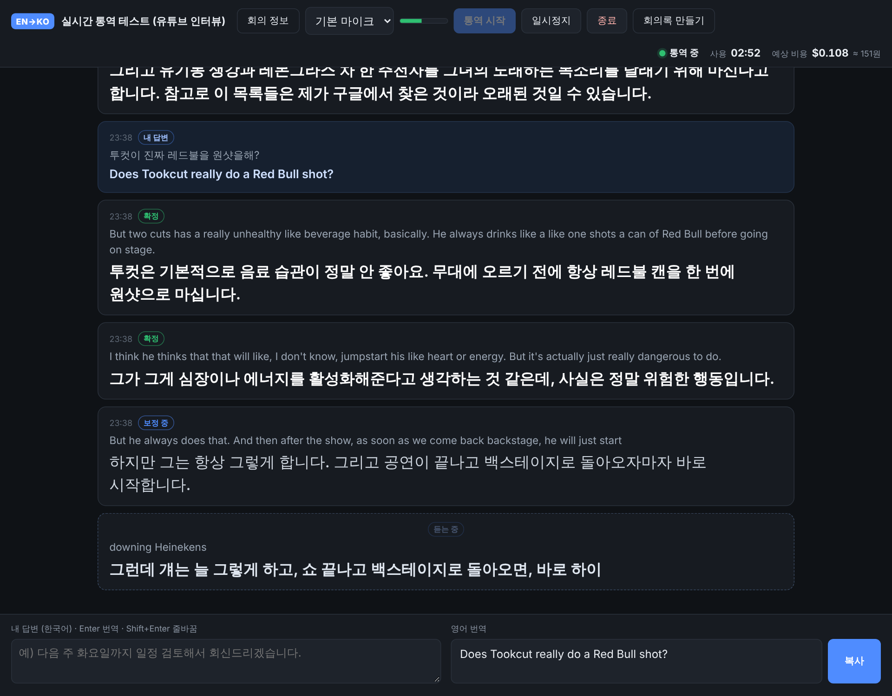
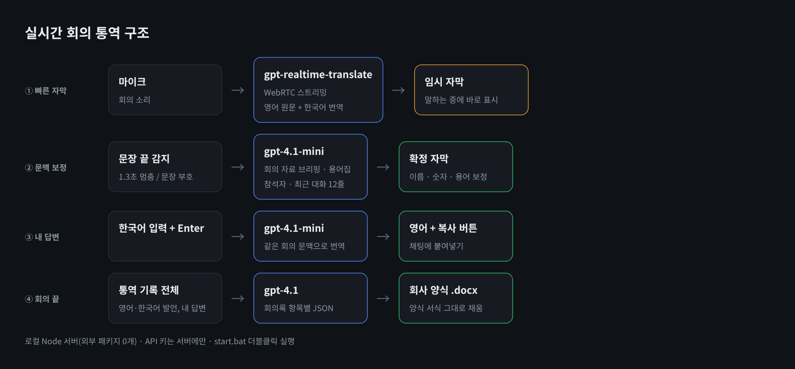

# 실시간 회의 통역 (EN → KO)

영어·한국어가 섞인 화상회의에서 **영어 발언을 실시간 한국어 자막**으로 보여주고, **내 한국어 답변을 회의 문맥에 맞는 영어**로 바꿔 주는 로컬 프로그램입니다. 회의가 끝나면 통역 기록으로 **회사 양식 회의록(.docx)**까지 만들어 줍니다.

## 특징

- **2단계 자막**: `gpt-realtime-translate`로 말하는 중에 임시 자막을 띄우고, 문장이 끝나면 회의 자료·용어집·최근 대화를 참고해 `gpt-4.1-mini`가 이름·숫자·용어를 보정합니다.
- **회의 자료 사전 입력**: Word·Excel·PowerPoint·PDF·텍스트를 끌어다 놓으면 통역용 브리핑으로 요약해 번역에 반영합니다.
- **한국어 답변 번역 + 복사**: 한국어를 쓰고 Enter → 회의 문맥에 맞는 영어 → 복사 버튼.
- **회의록 자동 작성**: `templates/회의록양식.docx`의 표와 서식에 그대로 채웁니다.
- **새 회의**: 지금 기록을 보관하고 화면·회의 정보·비용을 초기화합니다.
- **설정 화면**: API 키 입력·변경·삭제와 회사명을 화면에서 바로 저장합니다 (`.env` 직접 수정 불필요).
- **외부 패키지 0개**: Node.js만 있으면 `start.bat` 더블클릭으로 실행. API 키는 로컬 서버(`.env`)에만 보관합니다.
- 1시간 사용 시 약 $2.3~2.7 (실시간 번역 $0.034/분 + 보정 비용).

> 요구사항 원문은 [`실시간-회의-통역-요구사항.md`](실시간-회의-통역-요구사항.md)에 있습니다.
> `templates/회의록양식.docx`는 예시 양식입니다. 같은 구조(라벨 칸 + 내용 칸 표)의 자기 회사 양식으로 바꿔 쓰세요.

마이크로 들어오는 영어 발언을 한국어 자막으로 실시간 표시하고, 내가 입력한 한국어 답변을 회의 문맥에 맞는 영어로 번역하는 프로그램입니다.

## 처음 한 번만

1. **Node.js 설치**: https://nodejs.org 에서 LTS 버전을 설치합니다. 이미 설치되어 있으면 건너뜁니다.
2. **OpenAI API 키 준비**: 처음 실행하면 **설정** 창이 자동으로 열립니다. [platform.openai.com/api-keys](https://platform.openai.com/api-keys)에서 만든 키를 붙여 넣고 저장하세요. 저장할 때 OpenAI에 맞는 키인지 확인합니다.
   - 키를 바꾸거나 지울 때도 상단 **설정** 버튼에서 하면 됩니다. `.env` 파일을 직접 고칠 필요가 없습니다.
   - 회의록에 쓸 **회사명**도 설정 창에서 넣을 수 있습니다.

## 실행

1. `start.bat`을 더블클릭합니다. 검은 창이 뜨고 Chrome/Edge에서 `http://localhost:3000`이 열립니다.
2. **회의 정보**를 열어 회의 자료(Word·Excel·PowerPoint·PDF·텍스트)를 끌어다 놓습니다. 이름·용어·숫자 위주의 브리핑이 자동으로 만들어집니다.
3. 안건, 참석자, 용어를 보완하고 **저장하고 닫기**를 누릅니다.
4. 상단에서 소리 입력 방식을 고르고 **통역 시작**을 누릅니다.
   - **회의 소리 (탭·화면 공유)** (권장): 공유 창에서 Teams/Zoom 웹 탭을 고르거나, 데스크톱 앱이면 **전체 화면**을 고른 뒤 **오디오 공유**를 켭니다. 스피커 소리를 마이크로 다시 받지 않아 인식이 정확합니다.
   - **회의 소리 + 내 마이크**: 내 영어 발언도 통역하고 싶을 때. 헤드셋을 쓰세요 (스피커를 쓰면 상대 목소리가 두 번 들어감).
   - **마이크만**: 대면 회의용. 처음에는 마이크 권한을 허용해야 합니다.

### 회의실에서 다른 사람이 켠 회의를 함께 볼 때

회의 소리가 내 노트북을 거치지 않으므로, 내 노트북으로 **같은 회의에 한 번 더 참가**해 그 소리를 받습니다.

1. Chrome/Edge 새 탭에서 회의 링크를 열고 **웹으로 참가**합니다 (Teams·Zoom 모두 브라우저 참가 가능). **마이크·카메라는 끄고** 들어갑니다.
2. 통역 프로그램에서 **회의 소리 (탭·화면 공유)**를 고르고 통역 시작 → 공유 창에서 그 회의 탭을 고르고 **탭 오디오 공유**를 켭니다.
3. 회의 정보의 **공유한 탭 소리를 이 노트북에서 재생하지 않기**가 켜져 있으면 노트북 스피커로는 소리가 나지 않습니다 (기본값). 회의실 스피커와 소리가 겹치거나 하울링이 생기지 않습니다.

같은 회의에 참가할 수 없으면 **마이크만**을 고르고, 노트북을 회의실 스피커 가까이 두거나 외장 마이크를 스피커 쪽에 놓으세요. 내장 마이크로 멀리서 받으면 인식률이 크게 떨어집니다.
5. 답변할 때는 하단 입력창에 한국어를 쓰고 Enter를 누른 뒤 **복사** 버튼을 누릅니다.
6. 회의가 끝나면 **종료**를 누르고, 필요하면 회의 정보 창의 **기록 저장(.txt)**으로 기록을 저장합니다.

검은 창은 사용하는 동안 켜 두어야 합니다. 닫으면 프로그램도 종료됩니다.

## 회의록 만들기

회의가 끝나면 상단의 **회의록 만들기**를 누릅니다. 지금까지의 통역 기록(영어 원문·번역, 한국어 발언, 내 답변)과 회의 정보를 바탕으로 `templates/회의록양식.docx` 양식에 맞춘 Word 파일이 다운로드 폴더에 저장됩니다.

- 회의명, 일시(첫·마지막 기록 시각), 장소, 참석자, 작성자, 주요 Agenda, 회의 내용, 합의사항, 미결사항, 기타, Action Item을 채웁니다.
- 장소와 작성자는 회의 정보에서 입력합니다.
- 기록에 없는 담당자나 기한은 만들지 않고 비워 둡니다. 내보낸 뒤 Word에서 검토·보완하세요.
- 회의록 작성에는 `gpt-4.1`을 씁니다 (1시간 회의 기준 약 $0.05~0.1). `.env`의 `MINUTES_MODEL`로 바꿀 수 있습니다.
- 양식을 바꾸려면 `templates/회의록양식.docx` 파일을 같은 구조의 다른 양식으로 교체하면 됩니다.
- 통역 기록은 브라우저에 저장되어 새로고침해도 남습니다.

## 새 회의 시작 (초기화)

상단의 **새 회의**를 누르면 다음 회의를 깨끗하게 시작할 수 있습니다.

- 진행 중인 통역이 있으면 종료합니다.
- **지금 기록을 보관하기**(기본 켬): 지금까지의 통역 기록을 프로그램 폴더의 `기록` 폴더에 `.txt`로 저장한 뒤 화면에서 지웁니다.
- **회의 정보 비우기**(기본 켬): 제목·장소·안건·배경·참석자·자료 브리핑을 비웁니다. 용어집과 작성자, 마이크·소리 설정은 그대로 둡니다.
- 사용 시간과 예상 비용도 0부터 다시 셉니다. 정리가 끝나면 새 회의 정보를 입력하는 창이 열립니다.

## 동작 방식

- **임시 자막**: `gpt-realtime-translate`가 영어 음성을 바로 한국어로 번역해 보여줍니다. 가장 빠른 자막입니다.
- **확정 자막**: 말이 약 1.3초 멈추면 문장이 끝난 것으로 보고, 텍스트 모델(`gpt-4.1-mini`)이 회의 정보·자료 브리핑·최근 대화를 참고해 용어와 고유명사를 바로잡습니다. 보정이 끝나면 배지가 `임시`에서 `확정`으로 바뀝니다.
  - 실시간 번역 모델은 프롬프트나 용어집을 받지 않기 때문에 이렇게 두 단계로 구성했습니다.
- **원문 미인식 · 참고용**: 영어 원문 인식 없이 번역만 나온 문장입니다. 잡음에서 지어낸 번역일 수 있어 보정·확정하지 않고 흐리게 표시하며, 회의록에서도 근거로 쓰지 않도록 표시해 넘깁니다. 원문이 10초 안에 늦게 도착하면 그때 보정합니다.
- **원문 인식 정지 감지**: 번역은 계속 나오는데 원문 인식이 20초 넘게 멈추면 연결을 자동으로 새로 엽니다 (최대 90초에 한 번).
- **인식 힌트**: 회의 제목·참석자·용어집 원어를 음성 인식에 힌트로 넘겨 고유명사 오인식(J PASS → JPEG 등)을 줄입니다. 힌트를 받지 않는 모델이면 자동으로 힌트 없이 연결합니다.
- **한국어 발언**: 번역 자막을 띄우지 않고 회색 기록으로만 남겨 문맥 참고에 씁니다. 늦게 도착한 한국어 원문은 직전 영어 카드에 붙이지 않습니다.
- **이전 회의 기록**: 마지막 기록이 2시간 넘게 지난 상태에서 통역을 시작하면 지울지 묻습니다. 회의록은 2시간 넘게 끊긴 지점 이후 기록만 씁니다.
- **일시정지**: 연결을 끊기 때문에 정지 중에는 과금되지 않습니다. 다시 시작하면 새로 연결됩니다.
- **자동 재연결**: 네트워크가 끊기거나 세션이 만료되면 자동으로 다시 연결합니다.
- 번역 음성은 재생하지 않습니다.

## 마이크 팁

- 화상회의는 마이크 대신 **회의 소리 (탭·화면 공유)**를 쓰세요. 10/28 회의에서는 노트북 내장 마이크로 스피커 소리를 받아 원문 미인식이 81건(193건 중) 나왔습니다.
- 노트북 내장 마이크나 회의실 마이크를 쓸 때는 회의 정보 → 마이크 환경을 `회의실·노트북 내장 마이크`로 바꾸세요.
- 스피커로 나오는 상대방 목소리를 마이크로 받는 경우, 스피커 볼륨을 충분히 올려야 인식이 잘 됩니다.
- 상단의 초록 막대로 마이크 입력을 확인할 수 있습니다.

## 비용 (화면에 실시간 표시)

- 실시간 번역: 오디오 1분당 $0.034 (60분이면 약 $2.04, 약 2,900원)
- 문맥 보정·답변 번역·자료 요약: 텍스트 모델 토큰 비용이 별도로 들며, 보통 시간당 수백 원 수준입니다.
- 환율은 $1 = 1,400원으로 계산합니다. 세금과 카드 환율은 별도입니다.
- 비용을 줄이려면 회의 정보에서 `문장 종료 후 문맥 보정`을 끄면 됩니다. 이 경우 임시 자막만 표시됩니다.

## 설정 변경 (`.env`)

화면의 **설정**에서 API 키와 회사명을 바꿀 수 있습니다. 나머지 항목은 `.env.example`을 참고해 `.env`에 적습니다.

| 항목 | 기본값 | 설명 |
|---|---|---|
| `TEXT_MODEL` | `gpt-4.1-mini` | 보정·답변 번역 모델 |
| `PORT` | `3000` | 포트 |
| `MINUTES_MODEL` | `gpt-4.1` | 회의록 작성 모델 |
| `COMPANY_NAME` | (비움) | 회의록 작성자 기본값·회의록 프롬프트에 쓰는 회사명 |

## 문제 해결

| 증상 | 조치 |
|---|---|
| `Node.js is not installed` | nodejs.org에서 설치 후 다시 실행 |
| 마이크 권한 없음 | 주소창 왼쪽 아이콘 → 마이크 허용 → 새로고침 |
| 연결 실패 / 401 | 상단 **설정**에서 API 키를 다시 붙여 넣기 |
| 403 / 모델 없음 | OpenAI 계정에서 `gpt-realtime-translate` 사용 권한과 결제 수단 확인 |
| `.doc`/`.xls` 업로드 실패 | 다른 이름으로 저장해 `.docx`/`.xlsx`로 변환 |
| 스캔 PDF | 텍스트가 없는 이미지 PDF는 추출되지 않음 |
